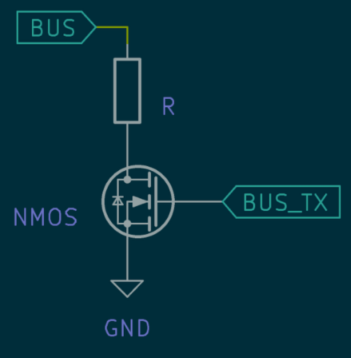

# MeterBus Observations

This document describes observations and measurements of the Morningstar MeterBus interface.

Morningstar MeterBus is a single-wire open-collector style serial bus exposed on an RJ11 connector.

## Power Supply

The Morningstar controllers supply some power via the RJ11 interface.

### Voltage

When testing the supply from a ProStar MPPT controller, the voltage appeared to be regulated to a maximum of 11.9VDC, but fell as the battery voltage dropped below 12.9VDC. Similar testing with a SunSaver MPPT controller seemed to show the output was regulated to about 14VDC. Battery voltage for the testing ranged from 5VDC up to and above 24VDC.

These observations fit within the range of 8VDC - 15.5VDC specified by Morningstar in [`Meterbus Adapter Instructions`](./operation-manual-pc-meterbus-adapter-en.pdf).

All power pins on the RJ11 connector appear to be bridged together, as do the ground pins.

### Current

Observed load-test results for the nominal 12 V supply:

| Load resistor | Measured voltage | Calculated current |
| ------------: | ---------------: | -----------------: |
|  Open circuit |           12.4 V |               0 mA |
|         150 Ω |            8.4 V |              56 mA |
|          67 Ω |            4.2 V |            62.7 mA |
|          33 Ω |            2.4 V |            72.7 mA |
|          0 Ω |            0 V |            13 mA |

Overall, the supply voltage sags heavily under load, while current rises into roughly the **55–75 mA** range over these tests.

## MeterBus

Measurements of the bus pin on both ProStar MPPT and SunSaver MPPT controllers show that the bus idles high at about 7.5VDC, and is pulled down to 0VDC when the controller transmits. The bus is a half-duplex serial line running at 9600 baud, with 8 data bits, 2 stop bits and no parity. 

The bus is weakly pulled up, and has a short circuit current to ground of about 700-800uA for both controllers.

### Bus Pull-Up

The internal circuit has not been confirmed by taking a controller apart. The model below is a theory based on how the bus behaves externally.

The bus behaves as if a zener diode from the bus to ground sets the 7.5VDC idle level, fed through a series 10kOhm resistor from the controller's main supply rail (the same rail that powers the RJ11 supply pins), rather than a 10kOhm pull-up to a dedicated 7.5VDC rail:

```
supply rail ---[ 10k ]---+--- bus pin
                         |
                       zener (~7.5V)
                         |
                        GND
```

In this model, the zener clamps the unloaded bus to about 7.5VDC. When the bus is pulled below the zener voltage, the zener stops conducting and the bus behaves like the supply rail behind a 10kOhm resistor.

Open question: this model does not fully match the measurements yet. With an 11.9-14VDC supply rail behind 10kOhm, the short circuit current should be about 1.2-1.4mA, but 700-800uA was measured, which implies only about 7-8VDC behind the 10kOhm resistor.

### Low Level Threshold

In order to figure out what bus voltage the controllers consider as a logic LOW, we tested several values of **R** in the test circuit pictured below while probing the bus with an oscilloscope.



The oscilloscope traces can be found in [this folder](../assets/bus_drive_resistors). The first block of data in the traces is the test circuit requesting the controller voltage over modbus, and the second block is the controller responding. Traces only show the first block of data when the controller did not respond.

The results showed that the controller stopped responding consistently at around 2.733kOhm, when the LOW level was around 1.3VDC.

If the zener model is correct, then below the zener voltage the bus should behave as a voltage divider between the internal 10kOhm resistor and **R**. The measured LOW levels are lower than a divider from an 11.9-14VDC supply would predict (about 2.6-3.0VDC at 2.733kOhm), and instead imply roughly 6VDC behind the 10kOhm resistor. This is the same mismatch noted under [Bus Pull-Up](#bus-pull-up).
